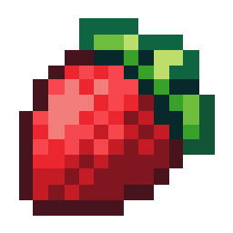

# 🏝️ Juego MTR



**Una aventura de exploración, misiones y supervivencia en una isla llena de misterios.**

🚧 **En desarrollo** · 🎮 **Aventura 2D** · 🛠️ **Godot 4.7**

## 📖 La historia

Un náufrago despierta en una isla desconocida sin recordar cómo llegó allí. Al explorar, descubre que sus habitantes son animales capaces de hablar, cada uno con su propia personalidad y desafíos.

Para escapar, deberá ayudarlos, completar sus misiones y reunir las piezas necesarias para construir un bote.

## ✨ Características

- 🗺️ **Exploración:** recorres la isla y descubres sus personajes y secretos.
- 🐾 **Misiones y diálogos:** conoces a los animales y aceptas sus desafíos.
- 🌱 **Cultivo y recursos:** trabajas la tierra y reúnes materiales.
- 🎒 **Inventario:** guardas y seleccionas objetos y herramientas.
- ⚔️ **Combate:** utilizas una espada para defenderte de los esqueletos.
- ❤️ **Supervivencia:** cuidas tu vida mientras avanzas en la aventura.

## 📸 Capturas

Capturas pendientes de agregar:

| Imagen | Contenido sugerido |
| --- | --- |
| Portada | Una vista general de la isla y el personaje. |
| Personajes | Un diálogo con alguno de los animales. |
| Jugabilidad | Una escena de cultivo o combate. |

<!-- Agregar las capturas al repositorio y reemplazar esta tabla por imágenes, por ejemplo:

-->

## 🚀 Cómo ejecutar el proyecto

1. Instala [Godot 4.7](https://godotengine.org/download/).
2. Clona el repositorio:

	```bash
	git clone https://github.com/MTR-Miceli-Tabuada-Ritter/Juego-MTR-Miceli-Ritter-Tabuada.git
	```

3. Abre Godot, importa el archivo `project.godot` del repositorio y espera a que se importen los recursos.
4. Ejecuta el proyecto con el botón **Ejecutar proyecto** o con **F5**.

## 🛠️ Tecnologías

- [Godot Engine](https://godotengine.org/) y GDScript.
- Dialogue Manager para los diálogos.
- Phantom Camera para las cámaras.

## 🚧 Estado del proyecto

El juego está en desarrollo y su nombre todavía no es definitivo. El equipo continúa trabajando en las mecánicas, la historia y la progresión principal; el contenido y el diseño pueden cambiar.

## 👥 Equipo

- Miceli
- Ritter
- Tabuada
- González Parodi

**Profesor:** Beitia
